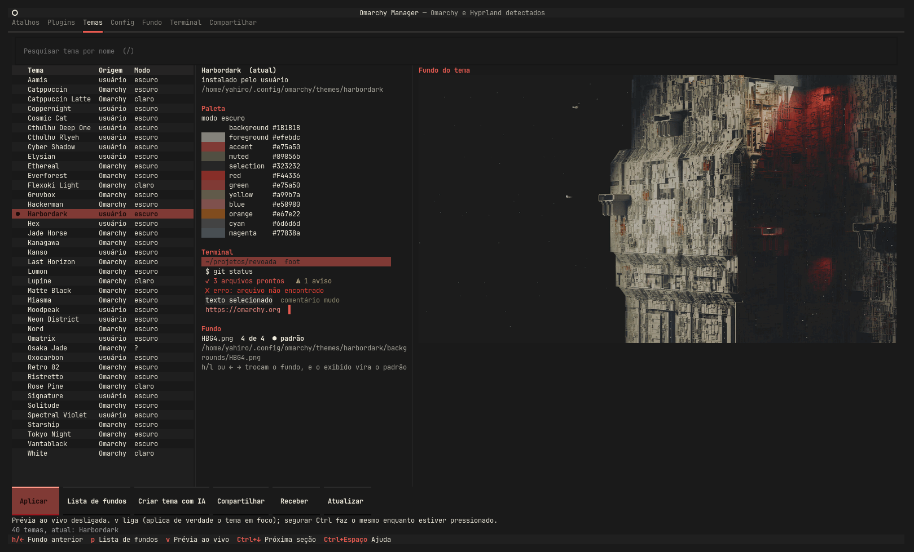
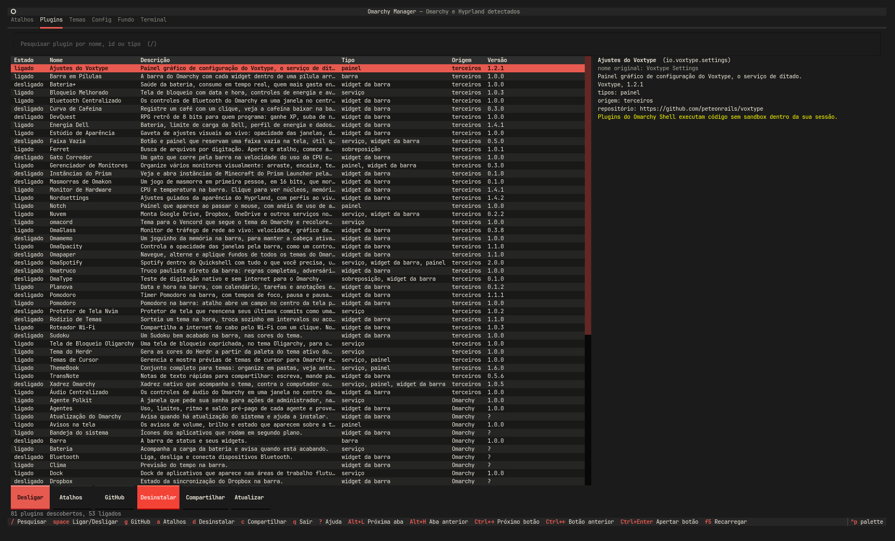
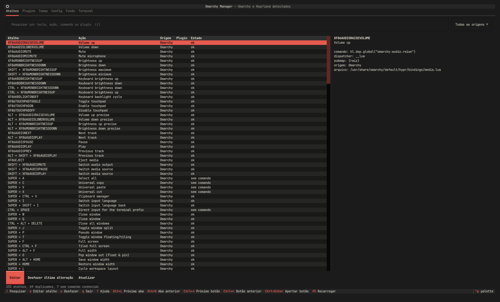
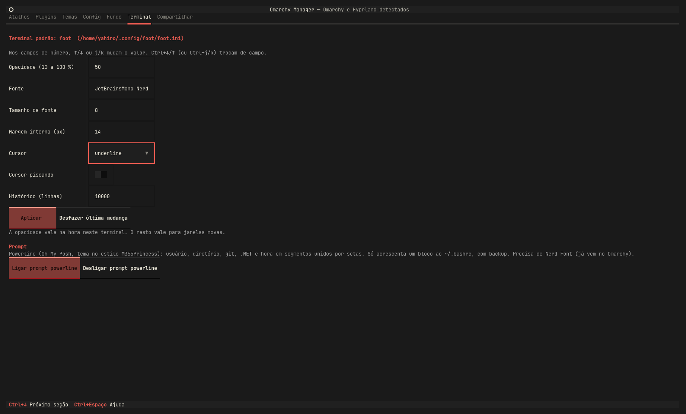
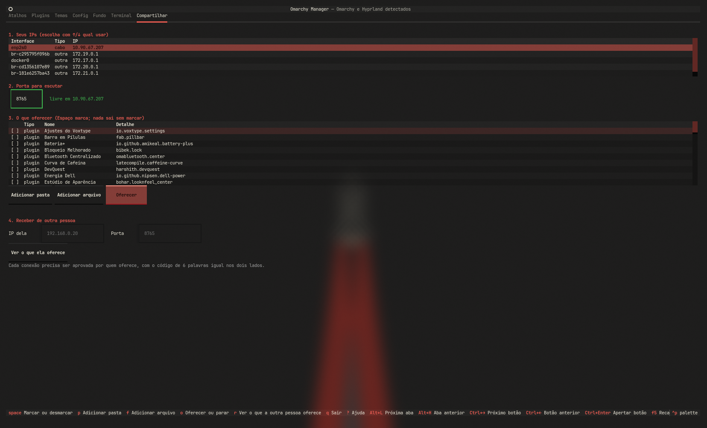
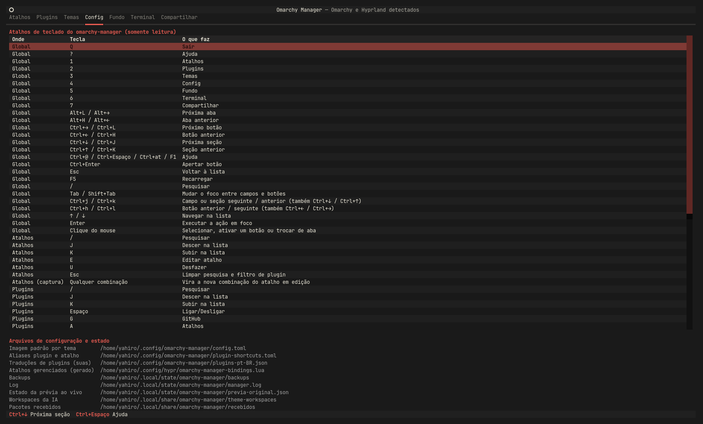

# omarchy-manager

TUI em Python (Textual) para o Omarchy: edita atalhos do Hyprland, liga e
desliga plugins do Omarchy Shell, troca temas e fundos e ajusta o terminal
Foot, tudo em português do Brasil e nas cores do tema ativo.

Versão 0.7.0. Testado com Omarchy 4.5 e Hyprland 0.56.2 (configuração Lua).

## Capturas de tela



Temas: paleta, exemplo de terminal e imagem de fundo do tema em foco.



Plugins: estado, descrição em português, tipo, origem e versão.



Atalhos: bindings efetivos do Hyprland, com origem e marcação de duplicados.



Terminal: edição do `foot.ini` e prompt Oh My Posh.



Compartilhar: IPs de cada interface, porta testada de verdade, itens marcados para oferecer e IP e porta da outra pessoa.



Config: todas as teclas do programa e os arquivos que ele usa.

## Recursos

- 7 abas: Atalhos, Plugins, Temas, Config, Fundo, Terminal e Compartilhar.
- Atalhos: edição com captura da combinação, aviso de conflito, backup e
  desfazer; reverte sozinho se o Hyprland acusar erro.
- Plugins: liga, desliga, desinstala (só de terceiros) e abre o repositório,
  com nome e descrição traduzidos.
- Temas: prévia da paleta e do fundo, prévia ao vivo, aplicar e criar tema
  com um agente de IA instalado.
- Fundo: qualquer png, jpg ou webp como fundo, sem trocar de tema.
- Terminal: opacidade, fonte, margem, cursor e histórico do Foot, mais o
  prompt Oh My Posh.
- Compartilhar plugins, temas, pastas e arquivos com outro computador da mesma rede, por HTTPS, com aprovação de cada conexão.
- Teclado e mouse.

## Instalar (como plugin do Omarchy)

```bash
omarchy plugin add https://github.com/JCsvg/omarchy-manager.git --enable
```

O Omarchy clona o repositório em
`~/.config/omarchy/plugins/io.github.jcsvg.omarchy-manager/`, valida o
manifesto e põe um ícone de engrenagem na barra. Clicar no ícone abre o
gerenciador em um terminal.

Aviso do próprio Omarchy, que vale aqui também: plugins rodam sem sandbox
dentro da sua sessão. Leia o código antes de instalar o de qualquer pessoa.

Na primeira abertura, se o Python do sistema não tiver o Textual, o
gerenciador cria um ambiente próprio em `~/.local/share/omarchy-manager/venv`
e instala ali `textual` e `qrcode` (precisa de internet, leva alguns
segundos). Para pular isso e usar os pacotes oficiais do Arch:

```bash
sudo pacman -S python-textual python-qrcode
```

Para chamar pelo terminal com o nome curto:

```bash
ln -s ~/.config/omarchy/plugins/io.github.jcsvg.omarchy-manager/bin/omarchy-manager ~/.local/bin/omarchy-manager
omarchy-manager
```

Atualizar: `omarchy plugin update io.github.jcsvg.omarchy-manager`

Remover: `omarchy plugin remove io.github.jcsvg.omarchy-manager`. Os arquivos
listados em "Arquivos do usuário" ficam; apague à mão se quiser. Se você
editou atalhos pelo gerenciador, apague também a linha de carregamento no fim
de `~/.config/hypr/bindings.lua` e o `omarchy-manager-bindings.lua`, e o
Hyprland volta aos atalhos originais no próximo reload.

Requisitos que já vêm com o Omarchy: `lua`, `hyprctl`, `omarchy`. Opcionais:
ImageMagick (`magick`) para a imagem dos fundos, `chafa` para blocos mais
nítidos em terminal sem gráficos, `openssl` e `avahi` para
o compartilhamento na rede local.

## Atalhos de teclado

| Tecla | O que faz |
|---|---|
| `Alt+L` / `Alt+→` | próxima aba (funciona de qualquer lugar, inclusive da pesquisa) |
| `Alt+H` / `Alt+←` | aba anterior |
| `1` a `7` | Atalhos, Plugins, Temas, Config, Fundo, Terminal, Compartilhar (fora de um campo de texto) |
| `/` | pesquisar |
| `j` `k` ou setas | navegar |
| `Enter` | executar a ação em foco |
| `Esc` | cancelar, limpar a pesquisa, desligar a prévia |
| `F5` | recarregar tudo |
| `?` | ajuda |
| `q` | sair |

Nos diálogos, `←`/`→` ou `h`/`l` movem entre os botões, `↑`/`↓` ou `j`/`k`
entre os campos, `Enter` ativa o botão em foco (o de cor cheia) e `Esc`
cancela. O mouse seleciona linhas, aperta botões e troca de aba. A aba Config lista
todos os atalhos do programa e os caminhos dos arquivos que ele usa.

### Aba Atalhos

Lista os bindings efetivos do Hyprland com comando e origem (Omarchy,
usuário, plugin, gerenciador), pesquisa, filtro por origem e marcação de
duplicados. `e` edita: você pressiona a nova combinação, o programa mostra se
está livre ou quem já usa, e só grava depois da confirmação. A gravação vai
apenas para `~/.config/hypr/omarchy-manager-bindings.lua` (mais uma linha de
carregamento no fim do seu `bindings.lua`), com backup, e é desfeita sozinha
se o Hyprland acusar erro de configuração. `u` desfaz a última alteração.

### Aba Plugins

Todos os plugins que o Omarchy conhece, com nome e descrição em português.
`Espaço` liga ou desliga, `g` abre o repositório, `a` mostra os atalhos do
plugin, `c` compartilha, `d` desinstala (só plugin de terceiros, com
confirmação).

As traduções ficam em `src/omarchy_manager/data/plugins-pt-BR.json`. Para
corrigir uma ou traduzir um plugin que não está lá, crie
`~/.config/omarchy-manager/plugins-pt-BR.json` no mesmo formato:

```json
{ "id.do.plugin": { "nome": "Nome em português", "descricao": "O que ele faz." } }
```

Sem tradução, aparece o texto original do plugin.

### Aba Temas

Lista os temas, com paleta, exemplo de terminal e a imagem de fundo ao
lado. Em terminal que desenha imagens (Sixel no Foot; protocolo kitty no
kitty e no Ghostty) ela aparece em pixels de verdade; nos outros, ou em
janela estreita, em blocos coloridos, com uma linha dizendo o motivo. `h`/`l` ou as
setas esquerda e direita percorrem os fundos do tema em foco, e o fundo que
estiver exibido passa a ser o padrão daquele tema, sem passo extra (a
prévia mostra a posição, como "2 de 5"). Isso só guarda a escolha; nada
muda na área de trabalho, a não ser com a prévia ao vivo ligada. `p` abre a
lista de fundos, que também serve para tirar o padrão. `Shift+Enter` troca só o fundo para a imagem exibida, sem trocar o tema. `Enter` aplica o tema e a imagem padrão,
depois de confirmar.

Prévia ao vivo: `v` liga. Com ela ligada, o tema em foco na lista é aplicado
de verdade na área de trabalho, e cada mudança de linha troca o tema (com
meio segundo de espera para não disparar em rajada). `v` ou `Esc` desligam e
voltam ao tema e ao fundo de antes; trocar de aba e sair fazem o mesmo.
`Enter` mantém o tema que está na prévia. Segurar `Ctrl` por meio segundo
faz a prévia do tema em foco, ou do tema sob o mouse, enquanto a tecla
estiver pressionada (ver limites abaixo). Se o programa for morto no meio de
uma prévia, a próxima abertura restaura o tema anterior.

`Criar tema com IA` abre um chat (Claude Code, Codex, OpenCode ou Copilot
CLI, o que estiver instalado) em um terminal novo, dentro de uma pasta de
trabalho própria, com o agente de `agents/criador-de-temas.md`.

### Aba Fundo

Escolhe qualquer imagem (png, jpg, webp) como fundo da tela **sem trocar de
tema**, usando `omarchy theme bg set`. Você digita o caminho de uma pasta no
campo de baixo e a aba lista as imagens dela e das subpastas (até 3
níveis), com prévia. A pasta fica lembrada em
`~/.config/omarchy-manager/fundo-pasta.txt`. `Enter` na lista aplica, `u`
volta ao fundo anterior desta sessão, e um caminho de imagem no campo aplica
na hora. O fundo vale até o próximo `omarchy theme set`, que refaz o fundo
do tema.

### Aba Terminal

Edita o `~/.config/foot/foot.ini` (por ora só o Foot): opacidade (10 a 100 %),
fonte, tamanho, margem interna, cursor, piscar e histórico. Cada gravação faz
backup em `~/.local/state/omarchy-manager/backups/` e "Desfazer" volta ao
último. A opacidade vale na hora neste terminal; o resto, em janelas novas.

A seção Prompt liga um prompt **powerline** do Oh My Posh (tema no estilo
M365Princess: usuário, diretório, git, .NET e hora em segmentos unidos por
setas). O tema fica em `~/.config/omarchy-manager/` e o `~/.bashrc` ganha só
um bloco entre marcadores, com backup. O botão de desligar remove o bloco.
Precisa do binário `oh-my-posh` em `~/.local/bin`.

### Aba Compartilhar

Oferece plugins de terceiros, temas do usuário, pastas e arquivos a outra
pessoa da mesma rede, ou lista e baixa o que ela oferece. Teclas: `Espaço`
marca ou desmarca o item em foco, `p` e `f` adicionam uma pasta ou um
arquivo pelo caminho, `o` liga ou desliga a oferta, `r` conecta ao IP e à
porta da outra pessoa, `j`/`k` e `Ctrl+←`/`Ctrl+→` como nas outras abas.

1. **Seus IPs.** Lista o IPv4 de cada interface (sem loopback), com o nome
   dela, cabo e Wi-Fi primeiro. A linha em foco é o IP em que o programa
   vai escutar.
2. **Porta.** O campo faz um bind de teste no IP escolhido a cada tecla:
   caixa verde se a porta está livre, vermelha se está ocupada, fora de 1 a
   65535 ou sem permissão (abaixo de 1024). O verde e o vermelho são fixos,
   porque em alguns temas o "verde" da paleta é avermelhado.
3. **O que oferecer.** A lista traz os plugins de terceiros e os temas do
   usuário, e recebe as pastas e arquivos que você adicionar. Nada vem
   marcado e nada é exposto sem marcar. Pasta vira pacote com as mesmas
   exclusões do `bundle.py` (`.git`, `*token*`, `*secret*`, `*credential*`,
   chaves, `.env`, caches, logs). Arquivo com nome desse tipo é recusado.
4. **Receber.** Digite o IP e a porta da outra pessoa. O programa mostra o
   código de 6 palavras do certificado dela; confira com ela, que vê o mesmo
   código no pedido de aprovação. Depois de aprovado, aparece a lista do que
   ela oferece e você marca o que baixar.

Salvaguardas: HTTPS com certificado criado para aquela oferta e
fingerprint fixada pelo cliente; cada conexão só lista ou baixa algo depois
de quem oferece aprovar, vendo o IP de quem conectou (60 segundos para
responder, senão é recusada); a lista mostra só o marcado; a oferta vale 30
minutos e some ao fechar o programa. Plugin e tema recebidos passam pela
mesma revisão do `Receber` (manifesto, licença, executáveis) e só são
instalados com um "sim": plugin desligado, tema sem ser aplicado. Pasta e
arquivo recebidos vão para `~/Downloads/omarchy-manager/` sem permissão de
execução, e se o nome já existe o programa pergunta antes de sobrescrever
(o antigo vai para o backup). Nada recebido é executado.

### Compartilhar plugin ou tema com `c`

Também continua o diálogo de um item só. Quem envia: `c` na aba Plugins (ou `Compartilhar` na aba Temas), depois
`Enviar na rede local`. Aparecem um código de 6 palavras, um convite em
texto e o QR Code do convite. Quem recebe: aba Temas, botão `Receber`, cola
o convite, confere se o código de 6 palavras é igual nos dois computadores e
baixa. Plugin recebido é instalado desligado; tema recebido não é aplicado.

Pelo terminal:

```bash
omarchy-manager share <id-do-plugin-ou-slug-do-tema>
omarchy-manager receive
```

A transferência é direta entre os dois computadores, por HTTPS com um
certificado criado só para aquele envio, vale por 10 minutos ou 1 download e
não passa por nenhum servidor na internet. Se a rede bloquear a conexão
entre os aparelhos, use `Guardar como arquivo` e mande o arquivo por outro
meio.

## Arquivos do usuário

```text
~/.config/omarchy-manager/config.toml            imagem padrão por tema
~/.config/omarchy-manager/plugin-shortcuts.toml  aliases plugin -> trecho de comando
~/.config/omarchy-manager/plugins-pt-BR.json     suas traduções de plugins
~/.config/hypr/omarchy-manager-bindings.lua      atalhos gerenciados (gerado)
~/.local/state/omarchy-manager/backups/          backups (20 mais recentes)
~/.local/state/omarchy-manager/manager.log       log de operações
~/.local/state/omarchy-manager/previa-original.json  tema a restaurar, só durante uma prévia
~/.local/share/omarchy-manager/                  ambiente Python, workspaces da IA, pacotes recebidos
```

Nada é gravado em `/usr/share/omarchy/`.

## Limites conhecidos

- Foot com fundo transparente: o `omarchy theme set` deixa opacos os Foot que
  já estão abertos (ele ignora o `alpha` do seu `foot.ini`). O gerenciador
  devolve a transparência à própria janela; as outras só voltam ao normal
  quando reabertas. Dentro do Herdr ou do tmux ele não consegue corrigir.

- Captura de `Super + tecla` na edição de atalhos: usa um submap temporário
  do Hyprland. A lógica tem teste, mas falta a validação com uma pessoa no
  teclado em todos os terminais.
- Prévia segurando `Ctrl`: o terminal não informa quando uma tecla é solta,
  então o programa pergunta ao Hyprland 4 vezes por segundo se o `Ctrl` está
  pressionado. Isso só foi testado com o estado do `Ctrl` simulado. Se não
  funcionar no seu teclado, a tecla `v` faz o mesmo de forma garantida.
- Compartilhamento (diálogos e aba Compartilhar): testado com os dois lados no mesmo computador, em 127.0.0.1. A
  descoberta automática (mDNS) entre aparelhos diferentes e o comportamento
  em Wi-Fi com isolamento de clientes ainda não foram validados; colar o
  convite ou ler o QR não depende da descoberta.
- O formato de plugin do Omarchy não tem campo para registrar atalho de
  teclado nem item de menu. Para abrir com uma tecla, adicione ao seu
  `~/.config/hypr/bindings.lua`, por exemplo:
  `o.bind("SUPER + CTRL + G", "Omarchy Manager", { tui = os.getenv("HOME") .. "/.config/omarchy/plugins/io.github.jcsvg.omarchy-manager/bin/omarchy-manager" })`

## Desenvolver

```bash
git clone https://github.com/JCsvg/omarchy-manager.git
cd omarchy-manager
uv venv --python 3.13 .venv
uv pip install --python .venv/bin/python -e ".[dev]"
.venv/bin/python -m pytest -q
bin/omarchy-manager
```

Também há um `packaging/PKGBUILD` para quem preferir um pacote Arch
(`packaging/empacotar.sh`, depois `sudo pacman -U`). Não instale o pacote e
o plugin ao mesmo tempo: são duas cópias do mesmo programa.

`DECISOES.md` registra as provas técnicas e o porquê de cada escolha.
Licença MIT.
